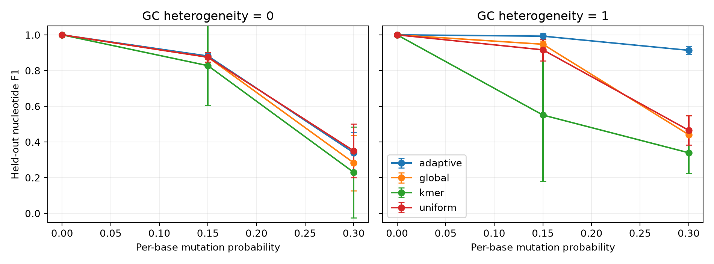

# BioMotifLab

**面向 DNA 序列的可解释基序发现、独立留出统计检验与交互分析平台。**

公开仓库：[Naterisy/BioMotifLab](https://github.com/Naterisy/BioMotifLab)。

BioMotifLab 用可检查的 Python 实现研究一个具体问题：当不同序列的 GC 组成不一致时，全局背景模型是否会混淆共同基序与组成偏差？项目实现双链 OOPS EM、序列级收缩背景、覆盖富集种子筛选、组成保持置换检验及真实可运行的 Streamlit 界面。它用于本科生物计算研究与教学，不据此推断实验结合或临床效果。

English: Transparent DNA motif discovery with sequence-specific shrinkage backgrounds, matched baselines, held-out permutation tests and reproducible experiments. The implemented model is **zero-order, two-strand OOPS**; this is an educational research implementation, not a replacement for MEME Suite.

## 功能

- FASTA 读取、严格校验，接受 IUPAC 模糊碱基并转为 N，跳过含 N 的候选窗口。
- 正反链搜索；输出 PWM、共识、原序列位置、方向、对数似然比及 Sequence Logo。
- 四种对照：`uniform` 均匀背景 EM、`global` 全局背景 EM、`adaptive` 逐序列收缩背景 EM、`kmer` 单候选词对照。
- 用户可上传发现集与独立检验集，调整长度、起点预算、EM 迭代、收缩强度、种子及置换次数，并实际执行多算法比较。
- 对固定训练所得 PWM，在留出序列计算双链最大窗口统计量、Monte Carlo p 值和序列间 BH 调整值。
- JSON、Markdown 分析报告导出；命令行还保存 PNG Logo。
- 真实 CRP 示例、可控合成数据、五个随机种子、基线/消融/参数/规模实验、原始记录与绘图代码。

## 安装与快速运行

需要 Python 3.10 或以上。本次验证环境为 macOS arm64、Python 3.13；完整实验脚本使用 Unix `resource`，Windows 用户可在 WSL 运行。下载仓库后进入项目根目录：

```bash
git clone https://github.com/Naterisy/BioMotifLab.git
cd BioMotifLab
python3 -m venv .venv
source .venv/bin/activate
python -m pip install --upgrade pip
python -m pip install -e '.[test]'
python -m pytest -q
```

`pyproject.toml` 声明兼容范围，`requirements-lock.txt` 保存本次实际实验环境的软件版本。若希望尽量匹配参考结果，可在相同 Python/操作系统环境先安装锁定依赖：

```bash
python -m pip install -r requirements-lock.txt
python -m pip install -e '.[test]'
```

若安装遇到证书链错误，应使用系统或机构提供的可信CA包，保持TLS校验。当前验证用macOS主机的可用方式如下；其他系统应替换为自己的CA路径：

```bash
PIP_CERT=/etc/ssl/cert.pem python -m pip install -e '.[test]'
```

启动界面：

```bash
streamlit run app.py
```

打开终端显示的本地地址，保留“使用内置可复现合成示例”可直接计算。上传 FASTA 时优先使用上传文件；有独立检验集时才执行显著性检验。界面限制每组最多 200 条、每条最多 2000 bp、总计最多 100000 bp，避免误提交造成长时间计算。命令行不设此交互限额，但仍受内存与候选窗口数量限制。

命令行的完整示例：

```bash
biomotiflab data/example/train.fasta \
  --test-fasta data/example/test.fasta \
  --width 10 --method adaptive --starts 8 --iterations 60 \
  --shrinkage 40 --seed 42 --shuffles 199 --out analysis/example
```

输出 `analysis/example/results.json`、`report.md` 和 `logo.png`。也可使用 `python -m biomotiflab.cli`。只提供训练 FASTA 时执行发现与描述，不生成训练数据上的误导性显著性。相同序列同时出现于两组时程序报错；近重复、反向互补和同源序列仍需使用者在划分数据时排除。

## 研究方法与贡献范围

PWM/PSSM、EM、OOPS、背景模型、种子搜索、置换检验和 Logo 均来自既有研究。项目独立实现的研究设计是：用链对称计数将每条序列背景向全局频率收缩，并用序列覆盖富集度选择有限个初始化词。前者应对序列间组成差异，后者限制单条序列中的重复词对起点的影响。它们是可消融的方法设计，**不主张发明 EM 或自适应背景，也未证明领域首创**。

令 cᵢᵦ 为链对称的碱基计数、gᵦ 为全局频率、τ 为收缩强度，则局部背景为：

```text
bᵢᵦ = (cᵢᵦ + τ gᵦ + 0.5) / (Σᵦ cᵢᵦ + τ + 2)
score(window) = Σⱼ log(PWMⱼ,base / bᵢ,base)
```

OOPS 假设每条训练序列恰有一个基序；每条序列的全部有效窗口及反向互补共同归一化责任度。四种方法使用相同数据与宽度，三种 EM 方法统一起点数上限、伪计数、停止规则。`kmer` 只输出一个候选词，不执行 EM。这里的 EM 是透明的简化实现，**没有运行外部 MEME/STREME 性能基准**，不能把结果表命名为 MEME 比较。

候选覆盖分数采用 Poisson 近似，仅用于启发式排序，不能当作正式 p 值。正式检验在独立序列上保持单碱基计数打乱，保留 N 的位置，每次重新取双链最大窗口，计算 `(1 + 超越次数)/(B + 1)`。B=199 时最小可报告 p=0.005。BH 调整针对单个模型的这一组检验序列，不覆盖用户反复选择算法或宽度。

完整的三方案比较、文献依据与选择理由见 [研究论证](docs/research.md)，已核验参考文献见 [references.json](docs/references.json)。

## 实验复现

先下载真实数据。脚本检查固定 CRP 文件哈希与 JASPAR PFM 内容哈希；上游内容改变会报错：

```bash
python scripts/download_data.py
# 如系统证书路径需要显式设置，可使用可信 CA 包，例如 macOS：
python scripts/download_data.py --cafile /etc/ssl/cert.pem
python scripts/run_experiments.py
python scripts/plot_results.py
# 阅读主实验结果后追加的探索性面板；不是预注册确认实验：
python scripts/run_motif_panel.py
# 独立进程资源测量：
python scripts/profile_resources.py
```

默认种子为 11、22、33、44、55。主实验各有 30 条训练和 30 条独立测试序列，长度80、真实基序宽度10、每碱基突变概率0/0.15/0.30、GC异质性0/1。异质性1使用每条序列GC=0.1或0.9的强压力场景，不代表典型启动子分布。各训练与测试序列独立生成；主实验共享一个固定共识模型，跨基序泛化证据有限；追加的探索性面板另用4个共识、3个种子和2种背景比较global/adaptive，共48次，且明确记录为主结果查看后设计。

```bash
# 更换重复种子或写到其他目录：
python scripts/run_experiments.py --seeds 11,22,33 --out results_check
```

`plot_results.py` 固定读取 `results/`；若使用自定义结果目录，需手动修改绘图脚本的输入目录，或将验证结果与 `results/` 逐文件比较；绘图脚本没有 `--out` 参数。重新运行默认实验会覆盖默认结果，建议先保存参考结果。随机序列、算法和统计量应可复现；时间、RSS和浮点末位可能随机器与依赖变化。

主要记录：

| 文件 | 内容 |
|---|---|
| `results/config.json` | 默认实验参数、随机种子与评测约定 |
| `results/raw.csv` | 175次发现实验的逐次指标与拟合耗时 |
| `results/details.json` | 每次合成实验的配置、训练模型、预测和植入真值 |
| `results/significance.csv` | 留出阳性/阴性序列的检验明细 |
| `results/real.json` | CRP划分索引、模型和留出检验记录 |
| `results/summary.csv` | 主实验均值与样本标准差 |
| `results/ablation_summary.csv` | 消融汇总 |
| `results/classification_summary.csv` | 有无基序分类及假阳性率汇总 |
| `results/motif_panel.csv` / `motif_panel.json` | 48次事后探索性跨基序实验与逐次模型/真值 |
| `results/resources.csv` | 各算法新建进程的基线与峰值RSS |
| `results/environment.json` | Python、平台、NumPy及整个进程峰值RSS |
| `results/figures/` | 完全由上述实测记录生成的图 |

定位主指标是预测区间与植入区间的核苷酸 Dice/F1：`2×交集长度/(预测长度+真值长度)`，在阳性序列上平均；不检查链方向。`exact_start` 是正链坐标起点恰好相同的比例，也不检查方向。有无基序分类指标另见 `classification_summary.csv`，不可与定位F1混用。

## 实测结果与不支持的假设

以下为5个种子的留出定位F1均值±样本标准差，来源为 `results/raw.csv`；高异质性情形为预设压力测试。

| GC异质性 | 突变概率 | k-mer | 均匀EM | 全局EM | 收缩背景EM |
|---|---:|---:|---:|---:|---:|
| 0 | 0.15 | 0.827±0.224 | 0.875±0.027 | 0.875±0.027 | 0.881±0.018 |
| 0 | 0.30 | 0.229±0.254 | 0.350±0.151 | 0.283±0.155 | 0.339±0.113 |
| 1 | 0.15 | 0.551±0.372 | 0.916±0.061 | 0.947±0.018 | 0.993±0.016 |
| 1 | 0.30 | 0.339±0.116 | 0.465±0.083 | 0.441±0.107 | 0.913±0.022 |

适应局部组成在所测强GC异质性条件下有效；均质且高噪声时没有全面优势。消融更限制了结论：去掉收缩的局部背景得到0.995±0.012，略高于默认0.993±0.016；随机种子替换富集种子仍为0.993±0.016。因此**本轮证据支持逐序列背景适配，尚不支持收缩或覆盖种子各自带来额外精度提升**。

真实CRP为18条105nt序列，每个种子用12条发现、6条留出，宽度20。按BH q≤0.05的留出序列数，adaptive与uniform平均均为0.6/6，global和kmer为0/6。此结果不能解释为真实位点准确率，重复划分也不是独立生物样本。没有导入可核验的位点真值，不报告CRP定位F1。追加的四基序探索面板在异质背景下adaptive/global平均F1为0.774/0.551，均质背景为0.474/0.464；均质AT富集基序上adaptive为0.430，低于global的0.467，仍保留该负结果。该面板是查看主结果后设计，不能称为预注册确认。

整个主实验进程实测峰值RSS约142.95 MiB；另外在4个新建独立进程中测得各算法峰值RSS为53.14–55.59 MiB，其中adaptive为55.03 MiB。数值包含解释器与依赖；高水位差值不是总内存分配量，单次资源测量不能替代多种规模的复杂度分析。



更详细的反例、评测边界与后续研究见 [limitations.md](docs/limitations.md)。

## 数据与许可证

项目自行编写的代码按 [MIT](LICENSE) 发布。第三方数据和软件继续遵循原许可：

- CRP：来自 [MEME 官方示例](https://meme-suite.org/meme/doc/meme.html)，源文件仅通过下载脚本获取，未纳入公开仓库。MEME有教育/科研/非营利及版权保留条件；本项目不将其重新授权为MIT。
- CTCF参考模型：JASPAR CORE固定版本MA0139.1，CC BY 4.0，保留原始API JSON与署名。来源 [JASPAR](https://jaspar.elixir.no/)，引用 JASPAR 2026，DOI [10.1093/nar/gkaf1209](https://doi.org/10.1093/nar/gkaf1209)。它是独立的已知PFM示例，不是细菌CRP的参考模型，也不是原始真实DNA序列数据集。
- 合成示例：本项目程序生成；植入真值与生成参数一并提供。

完整URL、用途、大小和SHA-256见 [data/real/manifest.json](data/real/manifest.json)；许可解释见 [data/real/README.md](data/real/README.md)。

## 工程结构与验证

```text
biomotiflab/       核心算法、FASTA、合成数据、统计检验、报告、CLI
app.py            Streamlit交互界面，直接调用同一算法模块
scripts/          合规下载、实验运行与绘图
tests/           核心、CLI、Streamlit实际回调、数据完整性测试
data/example/    可复现合成FASTA与真值
data/real/       公开矩阵、来源清单；下载的受约束原文被gitignore
results/         原始实验、汇总、图与环境信息
docs/            研究决策、局限性、学校格式来源与参考文献
```

本次干净虚拟环境安装及全套测试结果为 **17 passed、1 skipped**；跳过的是需显式启用的在线测试。默认测试不依赖网络；CRP未下载时相关本地完整性测试跳过，在线下载验证默认也跳过。需要显式在线验证时：

```bash
BIOMOTIFLAB_ONLINE_TEST=1 python -m pytest tests/test_data_sources.py -q
```

Streamlit集成测试使用AppTest真实执行校验、计算、图表和导出回调；由于AppTest没有上传控件赋值API，测试只将上传控件返回值替换为内存文件。它不是对浏览器上传组件本身的端到端自动化验证。公开部署的认证、限流、作业队列及多租户隔离不在当前实现范围；推荐本地运行。

公开论文版本应保持匿名，不含学号、姓名、学校账号或邮箱凭据。课程提交所需身份由提交者单独填写；邮件发送与QQ收件确认不属于本仓库的自动功能。
